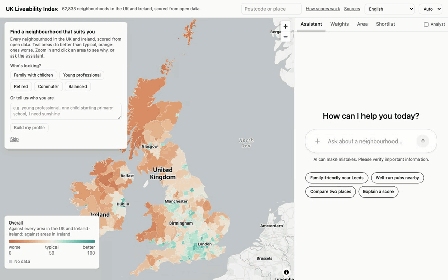
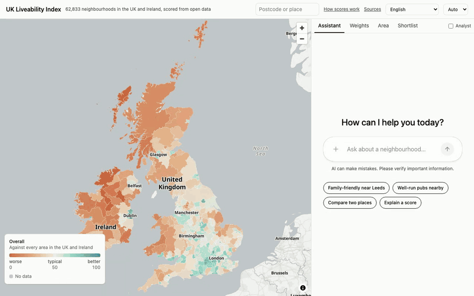
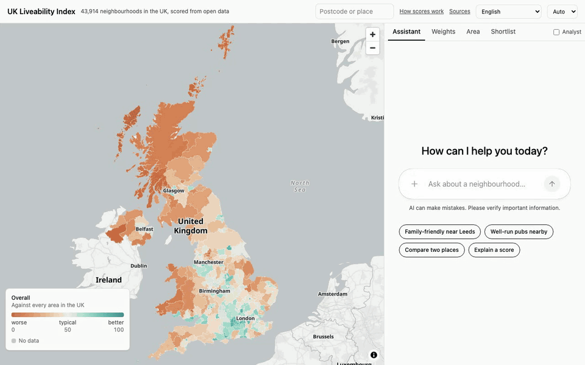
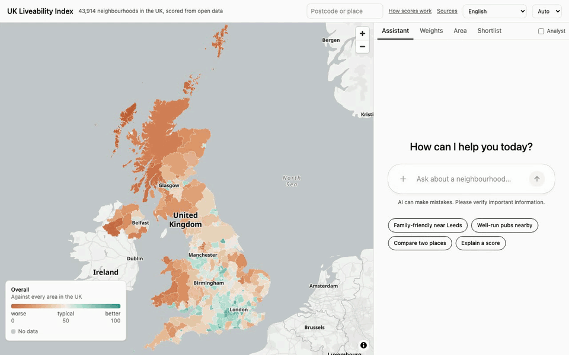
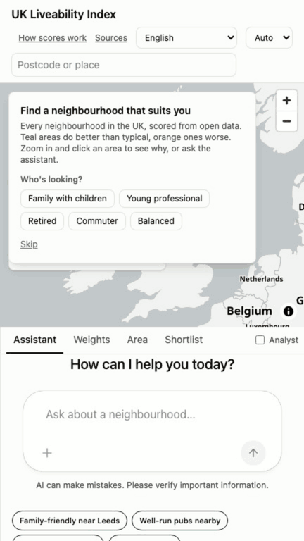

# UK Liveability Index

Every neighbourhood in the UK, scored from open data. Choose what matters to you (safety,
schools, green space, transport, pubs, prices…), see the whole country recolour, and ask an
assistant that answers with maps, profiles and comparisons instead of walls of text.



- **62,833 neighbourhoods** across the UK and Ireland (2021 LSOAs in England and Wales,
  2022 Data Zones in Scotland, 2021 Super Data Zones in Northern Ireland, 2022 Small Areas
  in Ireland; from a few hundred residents in Ireland and Scotland to a few thousand
  elsewhere), scored 0–100 on nine themes from **about 185 open datasets** (197 in the
  registry): police.uk, the PSNI and the CSO's Garda statistics, NHS,
  Ofsted, DfE, the Welsh and Scottish Governments and the Northern Ireland departments,
  Land Registry, Registers of Scotland and Land & Property Services, ONS, NRS, NISRA and
  the CSO, the SIMD, NIMDM and Pobal indices, Public Health Scotland, Defra and EEA air quality, the Met Office's
  HadUK-Grid climate averages, Environment Agency, Natural Resources Wales and SEPA flood
  maps, strategic noise maps, Ofcom broadband, bus and rail timetables, OpenStreetMap and
  more.
- **Your weights, computed in your browser**, from five ready-made personas, a sentence
  about yourself ("young professional, one child starting school, I need sunshine") or
  any weighting of your own, with an honest range for how much a result depends on them.
- **An assistant that shows its working**, tested on 58 cases, including that its replies
  only use numbers from the data ([evals](docs/evals.md)).
- **Open**: MIT code, open data under the ODbL, a documented and validated
  [method](docs/methodology.md). It runs on your own machine.

## Quickstart

You need [Docker](https://docs.docker.com/get-docker/) (with Compose), `make` and `curl`.
On Windows, use WSL (not tested yet).

```bash
git clone https://github.com/MysterionRise/uk-liveability-index.git
cd uk-liveability-index
make quickstart
```

That downloads the newest data release's pack (about 250 MB) and the app's images, and opens
http://localhost:3000. Stop it with `make down`.

**The assistant** needs a model key. Put an [OpenRouter](https://openrouter.ai) key in
`.env` (`make quickstart` creates it from [.env.example](.env.example)) and run `make up`.
Without a key, everything else works and the assistant answers its suggested questions
from recordings. See [Assistant](#assistant) for other providers and costs.

**Just a look?** `make up-demo` runs on the small dataset in the repo (Leeds, Brighton, Cardiff,
Edinburgh, Belfast and Dublin), with no download. Irish areas are found by place name
(Eircode is licensed, so there is no postcode search there).

## What you can do

**Search a postcode or place** to see its profile: the score on each theme against the
council, nation and UK medians, its strengths and weak spots, key facts, and how much
the result depends on the weights.



**Ask the assistant** to rank, compare or explain areas, or find well-run pubs, GPs and
schools nearby. Its answers are live components that move the map.



**Analyst mode** adds distributions, an overlap heatmap of the indicators, read-only SQL
over every neighbourhood and CSV export.



**On your phone** it works the same way: pick who you are, ask, tap, search.



Also: a shortlist with side-by-side comparison, shareable links, light and dark mode, and
the interface in English, Cymraeg, Gàidhlig or Gaeilge (drafts, until fluent speakers have
reviewed them; see
[docs/i18n.md](docs/i18n.md)).
A full walkthrough video comes with each
[release](https://github.com/MysterionRise/uk-liveability-index/releases).

## How the scores work

Each neighbourhood gets up to 102 indicators. The 44 that count towards the score are
turned into 0–100 scores, averaged within nine themes (safety, environment, health
services, schools and childcare, transport, amenities, housing, community and climate), and
the themes are weighted by what you choose. Measures that are the same everywhere
(distances, air quality, broadband, sunshine) are ranked across the UK and Ireland; those
each nation records its own way (crime, deprivation, schools, prices) are ranked within
the nation. The other indicators are shown for context, so related measures aren't counted
twice. Ireland's headline percentile and band compare its areas among themselves, because
it scores on fewer themes and stand-ins than the UK nations.

- **Fair to rural areas.** Access measures stop adding points beyond what a typical suburb
  has, and "compare like with like" ranks villages against villages.
- **Uncertain where it should be.** Nudging every theme's weight shows how stable a result is:
  "better than 72–95% of the UK" rather than a falsely precise 84%, and "close call" tags in
  rankings.
- **Checked.** A review of 59 contrasting places (139 checks, 98 of them run on every
  build) is in [docs/validation.md](docs/validation.md).

The full method, including how Greater Manchester's missing crime data and Ofsted's
framework changes are handled, is in [docs/methodology.md](docs/methodology.md), and every
source with its licence and date is in [docs/data-sources.md](docs/data-sources.md).

## Assistant

The assistant runs on any model [Pydantic AI](https://ai.pydantic.dev) supports. The
default is Claude Haiku 5.5 through OpenRouter, with an open-weights model on another
provider as the fallback:

| Model (via OpenRouter) | Eval cases passed | Typical answer | Cost per question |
|---|---|---|---|
| Claude Haiku 5.5 (default) | 58/58 | 5 s | about $0.001 |
| Qwen 3.8 27B (fallback, open weights) | 32/32 (the October 2026 suite) | 6 s | about $0.0017 |
| Claude Opus 5.5 | 32/32 (the October 2026 suite) | 7 s | about $0.05 |

The $1 daily budget buys several hundred Haiku questions and about twenty Opus ones (the
stable prefix is cached, so an Opus follow-up costs a few cents).

Set `LIX_MODEL` in `.env` to use another: `anthropic:claude-opus-5-5`, `openai:gpt-5`,
`google:gemini-2.5-pro`, or a local model with Ollama (`ollama:llama3.1`,
`docker compose --profile local-llm`).

**Caps, so a key can't run up a bill.** By default: 30 questions per conversation, 20 a
minute and $1 of spend a day, plus limits on each question's model requests, tool calls and
tokens. A refused question gets a chat reply and the map keeps working. Change them in
`.env`, and also set a credit limit on the key itself.

The same tools are available to Claude Desktop and other clients over
[MCP](https://modelcontextprotocol.io) at http://localhost:3000/mcp/.

## Limitations

- **The five nations publish different data.** A few indicators are England-only (life
  expectancy, GP capacity and ratings, primary school quality) and say so in the other
  nations' profiles. Where a nation has no source for an indicator but a comparable one of
  its own, that stands in and the interface says so: Scotland's recorded crime and access
  to services come from the SIMD, Northern Ireland's domestic rates replace council tax,
  Ireland's bus frequency stands in for the connectivity score and Pobal's index for income
  deprivation. Northern Ireland has no open flood map and no school grades or results, so
  its schools theme is shown as limited data and left out of its overall score; Ireland's
  schools and housing themes are gaps too, and its homes are building footprints rather
  than postcodes, since Eircode is licensed.
- **Neighbourhoods, not streets.** Scores describe areas of a few hundred to a few
  thousand residents, and distances are straight-line.
- **Data has dates.** Each source's data period is shown on the explainer card and in
  [docs/data-sources.md](docs/data-sources.md); the pack comes from a monthly data release
  ([docs/data-releases.md](docs/data-releases.md)). Crime in Greater Manchester is
  estimated, because its police force publishes none.
- **Judgement calls.** The weights, thresholds and choice of indicators are explained,
  not objective. Use the scores to explore, not as property, financial or legal advice.
- **Not yet included:** groundwater flooding, and the single garden trees and hedges
  that 10m satellite land cover cannot see (aircraft and industrial noise are mapped only
  where a nation publishes them). Welsh
  nurseries and pharmacies come from OpenStreetMap, and Welsh school quality from each
  council's exam results, because Wales publishes no open per-provider lists or grades.
  Scotland's deprivation index (SIMD 2020) is still on the 2011 Data Zones and is brought
  onto the 2022 zones through postcodes; Scottish house prices are Registers of Scotland's
  annual series on the 2011 zones, brought across the same way; bus timetables in Scotland are published voluntarily,
  so some operators are missing.

## Building the data yourself

The `lix` pipeline rebuilds everything from the original publishers: about 20 GB of
downloads, then staging, indicators, scores and map tiles.

```bash
make install       # uv sync (needs uv and Python 3.11)
make build-data    # fetch, stage, indicators, score, tiles, validate
make up BUILD=1    # build the images from this checkout
```

How the pipeline, API, assistant and front end fit together, and how to run their tests,
is in [docs/development.md](docs/development.md).

## Contributing

Issues and pull requests are welcome; see [CONTRIBUTING.md](CONTRIBUTING.md). Report
security problems privately ([SECURITY.md](SECURITY.md)).

## Licence

- **Code:** MIT ([LICENSE](LICENSE)).
- **Data:** the data pack is built from open data and released under the Open Database
  Licence because part of it comes from OpenStreetMap ([DATA-LICENCE.md](DATA-LICENCE.md)).
  Reuse must keep the notices in [ATTRIBUTION.md](ATTRIBUTION.md).

Contains public sector information licensed under the Open Government Licence v3.0; OS data,
Royal Mail data and GeoPlace data © Crown copyright and database right 2026; © OpenStreetMap
contributors.
